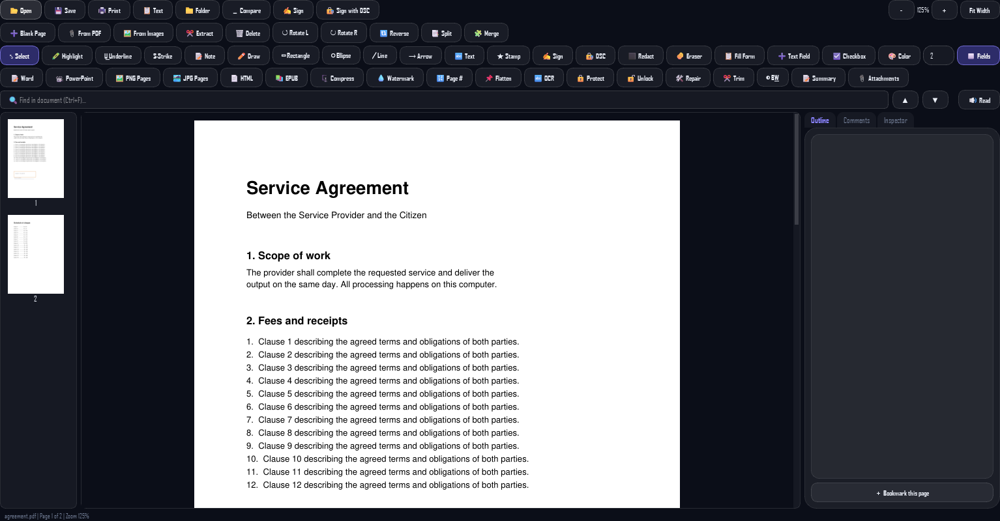
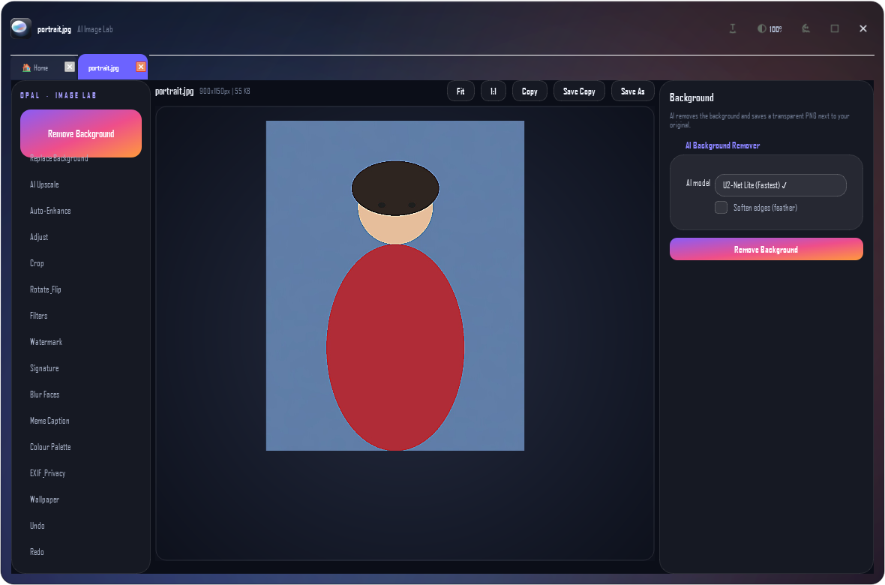
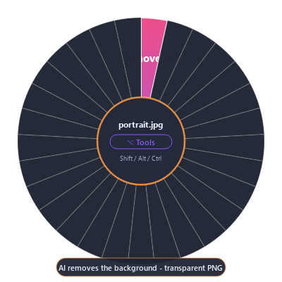
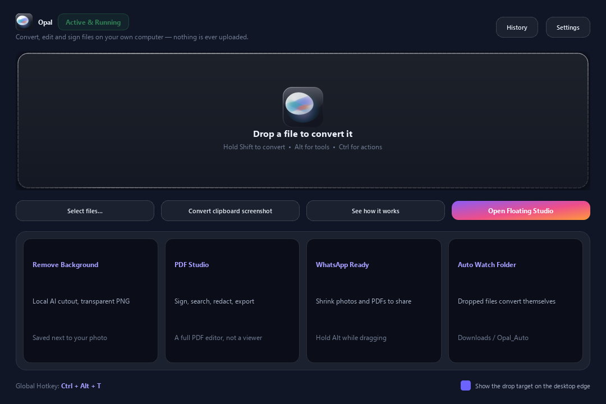

<div align="center">


# Opal

### Every file, in every light

**The offline file studio for Windows, macOS and Linux.**
Convert, edit, sign and finish any file — entirely on your own computer.

[](LICENSE)
[](https://www.python.org/downloads/)
[]()
[]()
[](https://github.com/gaurav-eshanura/opal/actions/workflows/ci.yml)

[Download](#-download) · [Features](#-what-it-does) · [Command line](#-command-line) · [Building](#-building-from-source) · [Privacy](#-privacy-and-security) · [Contributing](#-contributing)

</div>

---

An opal has no colour of its own. The fire comes from light bending inside the
stone, and it changes with the angle. **Opal does the same for your files**: one
file, every form it can take, made on your own machine in seconds.

Drop a file, hold a key, drop on what you want. Opal is a single pane of glass
that floats above your other windows and does the whole job — including the
things Acrobat is used for, and a few it never did.

<p align="center">
  
</p>

---

## 📥 Download

| Build | Size | What it is | Get it |
|---|---|---|---|
| **Opal** | 202 MB (103 MB zipped) | Everything except the heavy AI engines, which install on first use | [`Opal-v2.0.0-Windows-x64.zip`](https://github.com/gaurav-eshanura/opal/releases/latest) |
| **Opal Full** | 529 MB (232 MB zipped) | Everything bundled, including the cut-out model — works offline from the first click | [`Opal-Full-v2.0.0-Windows-x64.zip`](https://github.com/gaurav-eshanura/opal/releases/latest) |

macOS and Linux builds are produced by the scripts in [`build_macos.sh`](build_macos.sh)
and [`build_linux.sh`](build_linux.sh) — see [Building from source](#-building-from-source).

**Portable means portable.** There is no installer, no admin rights, no service
and no background daemon. Unzip it, run `Opal.exe`, and it works. Copy the
folder to a USB stick and it works on the next machine too.

<p align="center">
  
</p>

### Running it in portable mode

Create a file called `portable.txt` next to the executable. Opal then keeps its
settings, history and models **inside the folder** instead of your user
profile, and leaves nothing behind on a shared or counter PC.

---

## ✨ What it does

**70+ actions across 36 studio tools, every one of them tested end to end.**

### 🖼 Image Lab

Remove a background with 8 matting models · upscale 2×/4× · beautify · blur a
face · remove an object · meme captions · ID photo (413×599) · print 4R/5R/6R/8R
· WhatsApp photo · enhance · adjust · filters · crop · rotate · watermark ·
signature on a photo · colour palette · EXIF report and strip · favicon set ·
social presets · wallpaper · compress · contact sheet · QR code · web
optimisation

### 📄 PDF Studio — a real editor, not a viewer

Convert to Word, PowerPoint, EPUB, HTML, TXT, PNG, JPEG · annotate · **sign
with a real DSC certificate** · draw, type or upload a signature · redact ·
build and fill forms · offline OCR · watermark · page numbers · flatten ·
protect and unlock · merge · split · extract · reverse · rotate · insert ·
reorder · compress · fit to A4 · under 1 MB for WhatsApp · repair a broken
PDF · trim scanner margins · black-and-white photocopy · offline summary ·
compare two documents · print

### 🎬 Media Studio

MP4, MOV, MKV, WebM, AVI and more · MP3, WAV, M4A, FLAC, OGG, OPUS · convert
between them · trim · mute · compress · extract sound and frames · change
bitrate · normalise loudness

### 📑 Documents & Office

Word, Excel, PowerPoint, EPUB, RTF, ODT → PDF, HTML, TXT, images · extract
text, tables and images · Markdown, JSON, CSV, TSV, XML, YAML · archives
(zip, tar, gz) · fonts, code, subtitles and logs

### ⌨️ The wheel — the signature move

Hold **Shift** while you drag a file and a wheel appears: every format it can
become. Hold **Alt** for tools, **Ctrl** for actions. It works on Windows,
macOS and Linux.

<p align="center">
  
</p>

### 🪪 Digital signatures that are real

Sign a PDF with the PKCS#12 certificate (`.pfx` / `.p12`) your authority
issued — the same file an Indian DSC provider hands you. Opal shows the
certificate subject, issuer, serial and validity **before** you sign, produces
a standard `adbe.pkcs7.detached` signature, and the private key never leaves
your computer.

---

## ⌨️ Command line

The same engine, no window. Useful for scripts, batch jobs and hotkeys.

```powershell
opal_cli.bat --convert photo.HEIC --to png
opal_cli.bat --tool photo.jpg --to remove_bg
opal_cli.bat --convert invoice.pdf --to docx --out C:\Reports
opal_cli.bat --info report.pdf
opal_cli.bat --catalog
```

`--info` prints machine-readable JSON, so Opal drops straight into a script.

<p align="center">
  
</p>

---

## 🖥 Cross-platform

One codebase (`opal_studio/`), three platforms. Everything that touches the
operating system lives behind a single layer, `opal_studio/platform_compat.py`:

| | Windows | macOS | Linux |
|---|---|---|---|
| Open / reveal in file manager | Explorer | Finder | File manager |
| Terminal | PowerShell | Terminal | Terminal |
| Global hotkey (Ctrl+Alt+T) | Win32 `RegisterHotKey` | polled through CoreGraphics | polled through X11 |
| Drag-and-drop wheel | Shell COM | AppleScript | drop-to-apply |
| Click-through mode | Qt `WindowTransparentForInput` | same | same |
| Autostart entry | Registry `Run` key | Launch Agent | `.desktop` file |
| Right-click menu | Registry | Finder | — |
| Text-to-speech | SAPI | — | — |

---

## 🔒 Privacy and security

- **Nothing is uploaded.** Not one byte, not ever. Conversion, editing, OCR,
  signing and every AI model run on your machine.
- **No account, no telemetry, no sign-in screen.** There is no policy setting
  to change because there is nothing to change.
- **The only network traffic** is the one-time download of an optional model.
  Those downloads are checked three ways: the host must be on a fixed
  allow-list, the connection is pinned to a validated public address (so a DNS
  record cannot be flipped underneath us), and the file must look like a model
  and match a pinned SHA-256 fingerprint. Anything that fails is deleted, not
  cached.
- **Your documents stay on your disk.** Results are written next to the
  original under a new name. The original is never touched.
- **Archives cannot escape.** A crafted archive with a member named
  `../../something` is refused; every member is checked against the target
  folder before anything is written.
- **GPS and camera data** are stripped from your photos in one click.

These promises are checked by a suite of their own
(`tests/test_security.py`), so they cannot quietly regress.

---

## 🏗 Building from source

```bash
git clone https://github.com/gaurav-eshanura/opal.git
cd opal
python -m venv .venv && source .venv/bin/activate   # Windows: .venv\Scripts\activate
pip install -r requirements.txt
python -m opal_studio
```

### Making a portable build

```bash
pip install pyinstaller
python build_release.py --core     # small build, engines install on demand
python build_release.py            # full build, everything bundled
```

The result lands in `dist/Opal/` or `dist/Opal-Full/`.

To bundle FFmpeg in the full build, put the binary at `assets/bin/ffmpeg.exe`
(Windows), `assets/bin/ffmpeg` (macOS / Linux) or leave it on your `PATH`.

Cross-platform build scripts are provided: [`build_macos.sh`](build_macos.sh)
and [`build_linux.sh`](build_linux.sh).

---

## 🧪 Testing

Opal ships with an extensive verification suite. It runs the real engine, not
mocks: every catalogue action is executed against real sample files and each
output is re-opened with the matching reader, so a "successful" conversion that
produced a broken file counts as a failure.

```bash
python test_opal.py            # core suites
python test_opal.py --full     # adds the slow real-media suites
python tests/test_every_feature.py   # 165 checks: every action, every dialog
```

| Suite | Checks |
|---|---|
| Engine toolkit | 70 |
| PDF Studio | 38 |
| Viewers & floating shell | 44 |
| Application smoke test | 21 |
| Customer journey (CSC / print shop) | 31 |
| Cross-platform & portable mode | 45 |
| Security guarantees | 24 |
| Every feature (exhaustive) | 165 |

---

## 🗂 Project structure

```
opal_studio/            the application
  engine.py             the conversion and tools engine
  pdf_tools.py          the PDF toolkit
  viewer_pdf.py         the PDF Studio
  viewer_image.py       the AI Image Lab
  viewer_media.py       the Media Studio
  viewer_doc.py         the document viewer
  float_viewer.py       the floating studio shell
  dashboard.py          the command centre
  radial_widget.py      the action wheel
  theme.py              the brand palette and global stylesheet
  glass.py              the liquid-glass drawing code
  brand.py              the Opal mark
  platform_compat.py    everything that touches the operating system
  input_watch.py        cross-platform mouse and keyboard reading
  dsc_sign.py           DSC certificate signing
website/                the marketing site
tests/                  the verification suites
tools/                  the screenshot capture tool
```

---

## 🗺 Roadmap

- [x] Floating studio with a tabbed workspace
- [x] The modifier wheel
- [x] Full PDF editor with real DSC signing
- [x] On-device AI background removal, upscaling and OCR
- [x] Cross-platform input watcher
- [x] Portable mode
- [ ] More matting models, smaller and faster
- [ ] Batch jobs with a queue
- [ ] Plugin API for custom tools

---

## 🤝 Contributing

Contributions are welcome — see [CONTRIBUTING.md](CONTRIBUTING.md) for the
workflow, the code style and how to run the tests. Please open an issue first
for anything larger than a bug fix.

## 📄 License

[MIT](LICENSE) © 2026 Opal. This is an independent product and is not
affiliated with, endorsed by, or connected to any other converter.

## 🙏 Credits

Built on [PySide6](https://doc.qt.io/qtforpython/), [PyMuPDF](https://pymupdf.readthedocs.io/),
[ONNX Runtime](https://onnxruntime.ai/), [pyHanko](https://pyhanko.readthedocs.io/),
[Real-ESRGAN](https://github.com/xinntao/Real-ESRGAN), [RapidOCR](https://github.com/RapidAI/RapidOCR)
and [OpenCV](https://opencv.org/).
