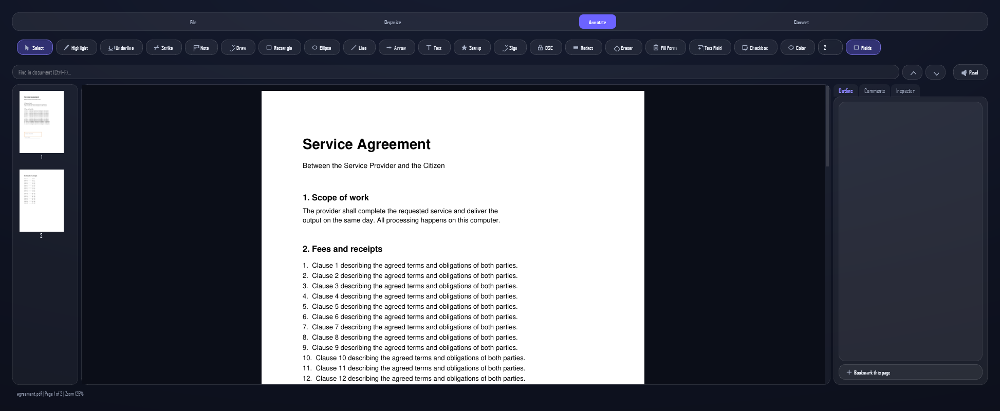
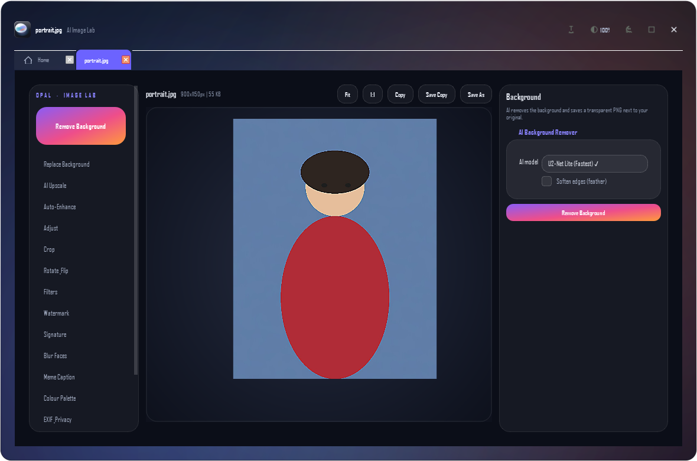
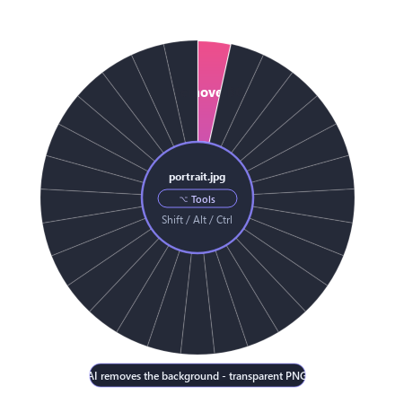
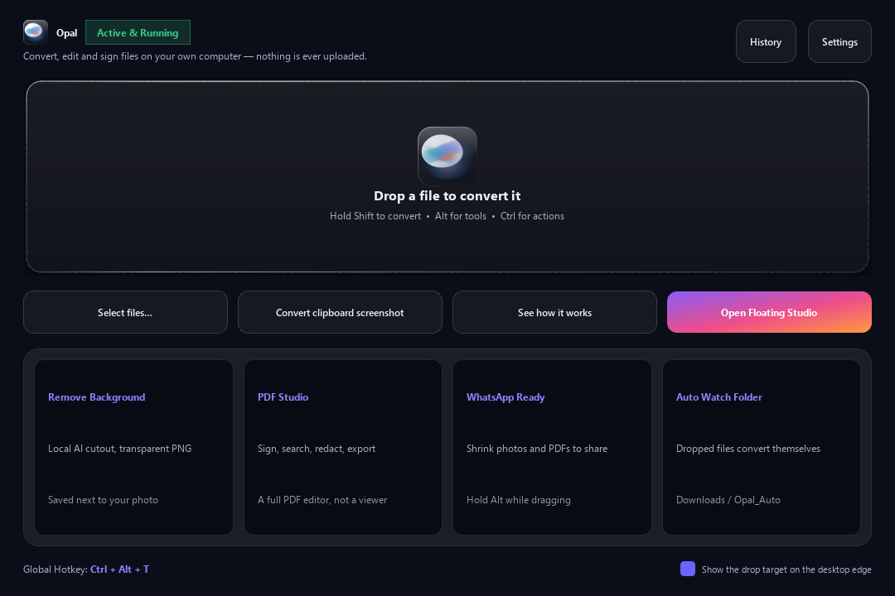

<div align="center">


# Opal

### Every file, in every light

**From Indian with Love ❤️**

**The offline file studio for Windows, macOS and Linux.**
Convert, edit, sign and finish any file — entirely on your own computer.

[](LICENSE)
[](https://www.python.org/downloads/)
[]()
[]()
[](https://github.com/gaurav-eshanura/opal/actions/workflows/ci.yml)

[Download](#-download) · [Features](#-what-it-does) · [Command line](#-command-line) · [Building](#-building-from-source) · [Privacy](#-privacy-and-security) · [Contributing](#-contributing)

</div>

---

An opal has no colour of its own. The fire comes from light bending inside the
stone, and it changes with the angle. **Opal does the same for your files**: one
file, every form it can take, made on your own machine in seconds.

Drop a file, hold a key, drop on what you want. Opal is a single pane of glass
that floats above your other windows and does the whole job — including the
things Acrobat is used for, and a few it never did.

<p align="center">
  
</p>

---

## 📥 Download

| Build | Size | What it is | Get it |
|---|---|---|---|
| **Opal** | 211 MB (99 MB zipped) | Everything except the heavy AI engines, which install on first use | [`Opal-v2.1.0-Windows-x64.zip`](https://github.com/gaurav-eshanura/opal/releases/latest) |
| **Opal Full** | 553 MB (222 MB zipped) | Everything bundled, including the cut-out model — works offline from the first click | [`Opal-Full-v2.1.0-Windows-x64.zip`](https://github.com/gaurav-eshanura/opal/releases/latest) |

macOS and Linux builds are produced by the scripts in [`build_macos.sh`](build_macos.sh)
and [`build_linux.sh`](build_linux.sh) — see [Building from source](#-building-from-source).

**Portable means portable.** There is no installer, no admin rights, no service
and no background daemon. Unzip it, run `Opal.exe`, and it works. Copy the
folder to a USB stick and it works on the next machine too.

<p align="center">
  
</p>

### Running it in portable mode

Create a file called `portable.txt` next to the executable. Opal then keeps its
settings, history and models **inside the folder** instead of your user
profile, and leaves nothing behind on a shared or counter PC.

---

## ✨ What it does

**103 actions in the wheel, 38 more in the catalogue. Every action that makes a
file is run against a real file, and the result is opened again to prove it
works.**

### 🖼 Image Lab

Remove a background with 8 matting models · upscale 2×/4× · beautify · blur a
face · remove an object · meme captions · ID photo (413×599) · print 4R/5R/6R/8R
· WhatsApp photo · enhance · adjust · filters · crop · rotate · watermark ·
signature on a photo · colour palette · EXIF report and strip · favicon set ·
social presets · wallpaper · compress · contact sheet · QR code · web
optimisation

### 📄 PDF Studio — a real editor, not a viewer

Convert to Word, PowerPoint, EPUB, HTML, TXT, PNG, JPEG · annotate · **sign
with a real DSC certificate or plugged-in USB token** (into a prepared
signature field when the form has one, with optional RFC 3161 timestamp) ·
**cryptographically verify signatures** · draw, type or upload a signature ·
redact · **search & redact** ·
build and fill forms · offline OCR · watermark · page numbers · flatten ·
protect and unlock · merge · split · extract · reverse · rotate · insert ·
reorder · compress · fit to A4 · under 1 MB for WhatsApp · repair a broken
PDF · trim scanner margins · black-and-white photocopy · offline summary ·
compare two documents · print

### 🎬 Media Studio

MP4, MOV, MKV, WebM, AVI and more · MP3, WAV, M4A, FLAC, OGG, OPUS · convert
between them · trim · mute · compress · extract sound and frames · change
bitrate · normalise loudness

### 📑 Documents & Office

Word, Excel, PowerPoint, EPUB, RTF, ODT → PDF, HTML, TXT, images · extract
text, tables and images · Markdown, JSON, CSV, TSV, XML, YAML · archives
(zip, tar, gz) · fonts, code, subtitles and logs

### ⌨️ The wheel — the signature move

Hold **Shift** while you drag a file and a wheel appears: every format it can
become. Hold **Alt** for tools, **Ctrl** for actions. It works on Windows,
macOS and Linux.

<p align="center">
  
</p>

### 🪪 Digital signatures that are real — no paid Acrobat needed

Adobe Acrobat Pro puts digitally signing a PDF behind a paid subscription.
Opal does the same job **free and fully offline**.

Sign a PDF with the PKCS#12 certificate (`.pfx` / `.p12`) your authority
issued — the same file an Indian DSC provider hands you — **or directly with
the DSC USB token plugged into the machine**, the way Acrobat does. Opal finds
the token's PKCS#11 driver by itself, shows the certificate subject, issuer,
serial and validity **before** you sign, and computes the signature inside
the token: the private key never leaves the device. The token PIN is asked
for in a dialog and held in memory only — never saved, logged, or put on a
command line. Opal signs into the form's own empty signature field when one is
prepared (exactly like Acrobat) and always writes a **signed copy** — your
original is never modified. The result is a standard `adbe.pkcs7.detached`
signature that any reader can verify — and Opal verifies it too, offline:
intact or tampered, who signed, certificate chain, revoked or not
(`--verify-signature`). Add `--tsa` for an optional RFC 3161 trusted
timestamp from an allow-listed server, which receives only the hash of the
signature, never the document.

---

## ⌨️ Command line

The same engine, no window. Useful for scripts, batch jobs and hotkeys.

```powershell
opal_cli.bat --convert photo.HEIC --to png
opal_cli.bat --tool photo.jpg --to remove_bg
opal_cli.bat --convert invoice.pdf --to docx --out C:\Reports
opal_cli.bat --convert scans/ --to pdf --out C:\Reports --recursive  # a whole folder at once
opal_cli.bat --convert scans/ --to pdf --json                         # one JSON summary for scripts
opal_cli.bat --sign contract.pdf --token                              # sign with the plugged-in DSC token
opal_cli.bat --sign contract.pdf --pfx cert.pfx --out signed.pdf      # sign with a certificate file
opal_cli.bat --sign contract.pdf --token --tsa https://freetsa.org/tsr   # ...with an RFC 3161 timestamp
opal_cli.bat --verify-signature signed.pdf                            # cryptographically validate signatures
opal_cli.bat --tool contract.pdf --to pdf_search_redact --options '{"query": "PAN"}'
opal_cli.bat --info report.pdf
opal_cli.bat --catalog
```

`--sign` reads the DSC PIN / certificate password from the `OPAL_DSC_PIN`
environment variable or asks for it interactively — never from the command
line — signs a copy (the original is never touched) and verifies the signature
before reporting success.

`--info` and `--json` print machine-readable JSON, so Opal drops straight into
a script. A folder argument means every supported file in it (files already
in the target format are skipped); `--recursive` includes subfolders.

<p align="center">
  
</p>

---

## 🔌 Plugins

Drop a `.py` file into the **plugins folder** — `plugins/` next to the app in
portable mode, otherwise the Opal data folder (`%APPDATA%\Opal\plugins`,
`~/.local/share/Opal/plugins`, `~/Library/Application Support/Opal/plugins`;
`OPAL_PLUGINS_DIR` overrides both) — and its tool appears in the wheel's
tools mode (Alt) next to the built-in ones.

```python
OPAL_PLUGIN = {
    "id": "upper",            # shows in the wheel as plugin:upper
    "label": "UPPERCASE",
    "desc": "Write the text back in capitals",
    "exts": [".txt"],         # optional; omit to apply to every file
}

def run(file_path, options=None):
    from pathlib import Path
    src = Path(file_path)
    dst = src.with_name(src.stem + "_upper.txt")
    dst.write_text(src.read_text(encoding="utf-8").upper(), encoding="utf-8")
    return {"success": True, "output_path": str(dst), "message": "Uppercased"}
```

A plugin that fails to load or raises while running is skipped with a reason
and reported — it never crashes Opal. Covered by `tests/test_plugins.py`.

---

## 🖥 Cross-platform

One codebase (`opal_studio/`), three platforms. Everything that touches the
operating system lives behind a single layer, `opal_studio/platform_compat.py`:

| | Windows | macOS | Linux |
|---|---|---|---|
| Open / reveal in file manager | Explorer | Finder | File manager |
| Terminal | PowerShell | Terminal | Terminal |
| Global hotkey (Ctrl+Alt+T) | Win32 `RegisterHotKey` | polled through CoreGraphics | polled through X11 |
| Drag-and-drop wheel | Shell COM | AppleScript | drop-to-apply |
| Click-through mode | Qt `WindowTransparentForInput` | same | same |
| Autostart entry | Registry `Run` key | Launch Agent | `.desktop` file |
| Right-click menu | Registry | needs an `.app` bundle | `.desktop` file |
| Text-to-speech | SAPI | — | — |

The right-click menu on macOS needs an `.app` bundle to declare the file
types it handles, so it is only registered when Opal is running as a bundle.
Everything else works the same on all three.

---

## 🔒 Privacy and security

- **Nothing is uploaded.** Not one byte, not ever. Conversion, editing, OCR,
  signing and every AI model run on your machine.
- **No account, no telemetry, no sign-in screen.** There is no policy setting
  to change because there is nothing to change.
- **The only network traffic** is the one-time download of an optional model
  and, only if you ask for it, an RFC 3161 timestamp when signing (`--tsa`).
  Model downloads are checked three ways: the host must be on a fixed
  allow-list, the connection is pinned to a validated public address (so a DNS
  record cannot be flipped underneath us), and the file must look like a model
  and match a pinned SHA-256 fingerprint. Anything that fails is deleted, not
  cached. Timestamp servers are likewise host-allow-listed, and a timestamp
  server receives only the hash of your signature — never the document.
- **Your documents stay on your disk.** Results are written next to the
  original under a new name. The original is never touched.
- **Archives cannot escape.** A crafted archive with a member named
  `../../something` is refused; every member is checked against the target
  folder before anything is written.
- **GPS and camera data** are stripped from your photos in one click.

These promises are checked by a suite of their own
(`tests/test_security.py`), so they cannot quietly regress.

---

## 🏗 Building from source

```bash
git clone https://github.com/gaurav-eshanura/opal.git
cd opal
python -m venv .venv && source .venv/bin/activate   # Windows: .venv\Scripts\activate
pip install -r requirements.txt
python -m opal_studio
```

### Making a portable build

```bash
pip install pyinstaller
python build_release.py --core     # small build, engines install on demand
python build_release.py            # full build, everything bundled
```

The app lands in `dist/Opal/` or `dist/Opal-Full/`, and the build then packs it
into the archive people actually download:

```
dist/Opal-v2.0.1-Windows-x64.zip          (also copied to website/downloads/)
dist/Opal-Full-v2.0.1-Windows-x64.zip     (also copied to website/downloads/)
```

That copy into `website/downloads/` is what makes the download button on the
site point at a real file.

To bundle FFmpeg in the full build, put the binary at `assets/bin/ffmpeg.exe`
(Windows), `assets/bin/ffmpeg` (macOS / Linux) or leave it on your `PATH`.

Cross-platform build scripts are provided: [`build_macos.sh`](build_macos.sh)
and [`build_linux.sh`](build_linux.sh).

---

## 🧪 Testing

The suite is **pytest**, and it can fail. It runs the real engine, not mocks:
every action is executed against real sample files the suite builds itself,
and each output is re-opened with the matching reader — so a "successful"
conversion that produced a file nothing can open counts as a failure.

```bash
python -m pytest tests/ -q              # the whole suite
python -m pytest tests/ -q -k menu      # one part of it
```

| Suite | What it covers |
|---|---|
| `test_menu_contract.py` | every wheel action × the file types it applies to (298 cases) |
| `test_catalog_contract.py` | all 38 catalogue actions, plus the guards around them |
| `test_watch_folder.py` | a file dropped into a watched folder, end to end |
| `test_every_feature.py` | every dialog, the cross-platform layer and the CLI |
| `test_viewers.py` | the Image Lab, Document Studio, Media Studio and the floating shell |
| `test_legacy_suites.py` | the old print-only suites, now run where a failed check is a failed test |
| `test_dsc_token.py` | DSC USB-token signing: error paths, a monkeypatched token that signs for real, and a live probe when a token is plugged in |
| `test_parity.py` | Acrobat-parity additions: sign into prepared signature fields, cryptographic verify, search & redact, TSA timestamping |
| `test_security.py` | the privacy and path-confinement promises |

Two groups are deliberately **skipped** rather than counted as passes: the
Real-ESRGAN upscaler (minutes per image on the CPU) and the desktop-only
suites that open Explorer, a terminal or MS Office. Ask for them by name:

```bash
OPAL_RUN_SLOW=1 python -m pytest tests/ -q       # adds the AI upscaler
OPAL_RUN_DESKTOP=1 python -m pytest tests/ -q    # adds the desktop suites
```

The number the website quotes is measured, not estimated:

```bash
python tools/bench_counter.py     # ten real counter jobs, back to back
```

Every one of these runs on **Windows, macOS and Linux**, on Python 3.11 and
3.12, in the CI pipeline on every push. The CI also builds the portable
Windows app and fails if it grows past its size budget.

---

## 🗂 Project structure

```
opal_studio/            the application
  engine.py             the conversion and tools engine
  pdf_tools.py          the PDF toolkit
  viewer_pdf.py         the PDF Studio
  viewer_image.py       the AI Image Lab
  viewer_media.py       the Media Studio
  viewer_doc.py         the document viewer
  float_viewer.py       the floating studio shell
  dashboard.py          the command centre
  radial_widget.py      the action wheel
  theme.py              the brand palette and global stylesheet
  glass.py              the liquid-glass drawing code
  brand.py              the Opal mark
  platform_compat.py    everything that touches the operating system
  input_watch.py        cross-platform mouse and keyboard reading
  dsc_sign.py           DSC certificate signing (.pfx and USB tokens)
  dsc_token.py          PKCS#11 access to a plugged-in DSC USB token
website/                the marketing site
tests/                  the verification suites
tools/                  the screenshot capture tool
```

---

## 🗺 Roadmap

- [x] Floating studio with a tabbed workspace
- [x] The modifier wheel
- [x] Full PDF editor with real DSC signing
- [x] On-device AI background removal, upscaling and OCR
- [x] Cross-platform input watcher
- [x] Portable mode
- [ ] More matting models, smaller and faster
- [x] Batch jobs with a queue — one runs at a time, the rest wait in order and
  the dashboard header shows "Working · N queued"
- [x] Plugin API — drop a `.py` into the plugins folder and it joins the wheel

---

## 🤝 Contributing

Contributions are welcome — see [CONTRIBUTING.md](CONTRIBUTING.md) for the
workflow, the code style and how to run the tests. Please open an issue first
for anything larger than a bug fix.

## 📄 License

[MIT](LICENSE) © 2026 Opal. This is an independent product and is not
affiliated with, endorsed by, or connected to any other converter.

## 🙏 Credits

Built on [PySide6](https://doc.qt.io/qtforpython/), [PyMuPDF](https://pymupdf.readthedocs.io/),
[ONNX Runtime](https://onnxruntime.ai/), [pyHanko](https://pyhanko.readthedocs.io/),
[Real-ESRGAN](https://github.com/xinntao/Real-ESRGAN), [RapidOCR](https://github.com/RapidAI/RapidOCR)
and [OpenCV](https://opencv.org/).
